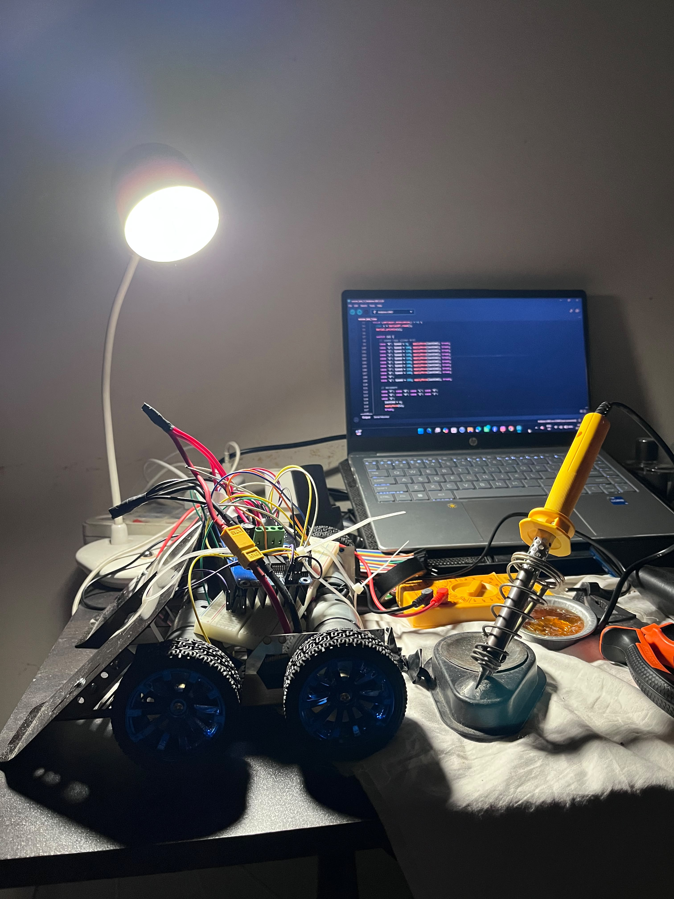

# 🏎️ ESP32 High-Speed Bluetooth Soccer Robot

An advanced, high-performance soccer robot engineered for speed, high torque, and precision maneuverability using ESP32 architecture and high-current motor drivers.

---

## 📌 Project Overview
This project features a heavy-duty robotics platform powered by an **ESP32 microcontroller**. Designed specifically for robotics soccer segments, the bot utilizes dual **BTS7960 motor drivers** to handle intense current demands, an **XL4015 Buck Converter** for step-down power regulation, and an **11.1V 3S LiPo battery** for high-speed responsiveness via custom Bluetooth PWM logic.

---

## 🛠️ Hardware Specifications & Architecture

| Component | Specification / Model | Purpose |
| :--- | :--- | :--- |
| **Microcontroller** | ESP32 Wi-Fi + Bluetooth Module | Core logic controller & wireless receiver |
| **Motor Drivers** | 2x BTS7960 (43A Max Peak Current) | High-current DC motor speed/direction control |
| **Motors** | 2x 37GB 800 RPM Metal Gear Motors | Dynamic driving speed and push torque |
| **Power Source** | 11.1V 3S LiPo Battery (High C-Rating) | Main power supply for high-current motors |
| **Voltage Regulator**| XL4015 Step-Down Buck Module | Regulates 11.1V to stable 5V DC for ESP32 |

---

## ✨ Key Features & Technical Capabilities

- **⚡ High Acceleration:** Direct 11.1V power routing to BTS7960 drivers for maximum torque and fast response.
- **🎮 Smooth PWM Speed Modulation:** Real-time speed control over Bluetooth for dribbling, positioning, and sprinting.
- **🛡️ Regulated Logic Circuitry:** XL4015 module prevents voltage spikes from entering the ESP32 logic board.
- **🔄 Modular Design:** Flexible code structure allowing instant motor dynamic speed tuning (0–255 PWM scale).

---

## 🔌 Circuit & Power Flow

```
                     [ 11.1V 3S LiPo Battery ]
                                 │
           ┌─────────────────────┴─────────────────────┐
           ▼                                           ▼
[ BTS7960 Driver 1 & 2 ]                    [ XL4015 Buck Converter ]
(High-Current Power Line)                   (Step-down to 5V DC)
           │                                           │
           ▼                                           ▼
[ 2x 37GB Motors ]                          [ ESP32 VIN & GND ]
 (800 RPM Output)                          (Logic Power Line)
                                                       │
                                                       ▼
                                            [ Bluetooth Serial Interface ]
                                           (PWM Controls -> BTS7960 Inputs)
```


## 📸 Team & Development


