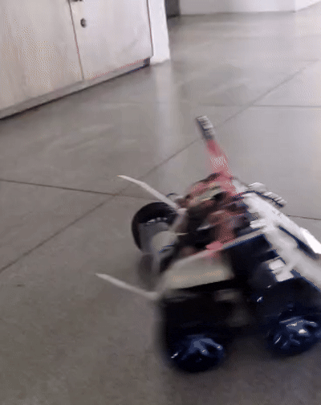
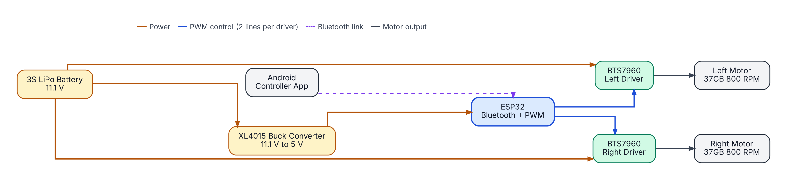
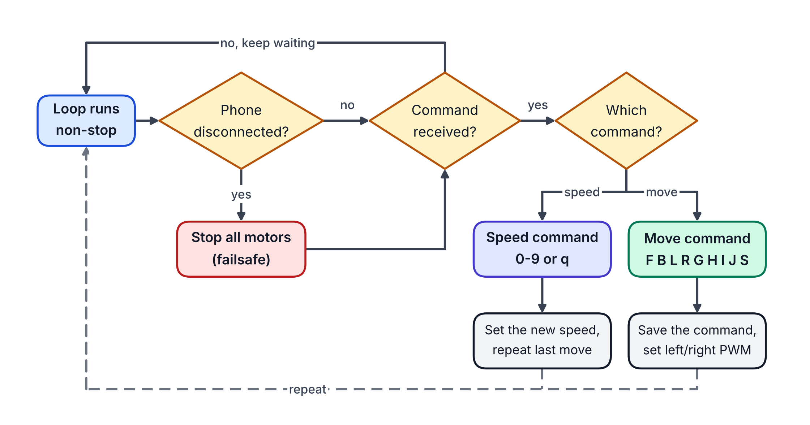
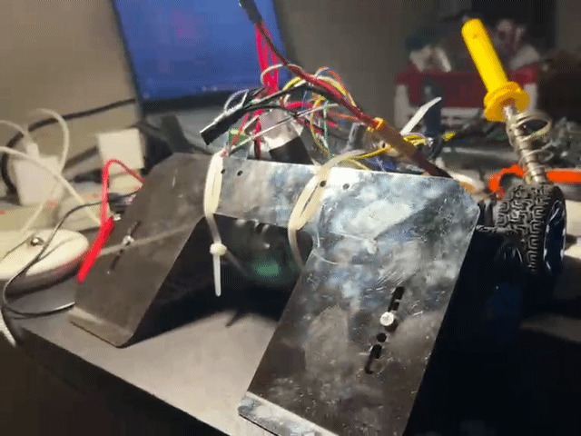

<h1 align="center">ESP32 Bluetooth Soccer Robot</h1>

  <b>A fast, high-torque soccer robot controlled over Bluetooth. Built with an ESP32, two BTS7960 motor drivers and a 3S LiPo battery.</b>

  
  
  
  
  
  

  

> Our team-built robot for robot soccer competitions. This repository has the firmware, wiring details and reports from the events we have competed in.

---

## Table of Contents

- [Overview](#overview)
- [Key Features](#key-features)
- [Hardware](#hardware)
- [System Architecture](#system-architecture)
- [Wiring and Pin Map](#wiring-and-pin-map)
- [Firmware](#firmware)
- [Getting Started](#getting-started)
- [Gallery](#gallery)
- [Competitions](#competitions)
- [Future Improvements](#future-improvements)
- [License](#license)
- [Team](#team)

---

## Overview

This is a two-motor, tank-style robot made for robot soccer. In this game, strong pushing power and quick direction changes matter more than top speed.

An **ESP32** receives simple one-letter commands from an Android app over Bluetooth. It turns them into PWM signals for two **BTS7960** motor drivers. The motors run directly from an **11.1 V 3S LiPo** battery, and a separate **XL4015** buck converter gives the ESP32 a stable 5 V supply.

---

## Key Features

- **Strong drive:** the BTS7960 drivers (43 A peak each) are powered straight from the battery for high torque and fast response.
- **Full movement control:** forward, backward, spin left, spin right, four curved moves and stop.
- **Adjustable speed:** ten speed levels that change instantly, even while the robot is moving.
- **Low-noise motors:** 20 kHz PWM keeps the motors free from audible whine.
- **Bluetooth failsafe:** the robot stops on its own if the phone disconnects.
- **Works on both ESP32 cores:** the code builds on Arduino core 2.x and 3.x.
- **Separate logic power:** the ESP32 runs from its own regulated 5 V supply.

---

## Hardware

| Component | Specification | Role |
|:--|:--|:--|
| **Microcontroller** | ESP32 (WROOM-32), Wi-Fi + Bluetooth | Receives commands and creates PWM signals |
| **Motor drivers** | 2x BTS7960 (43 A peak) | Control motor speed and direction |
| **Motors** | 2x 37GB 800 RPM metal gear motors | Drive and pushing power |
| **Battery** | 11.1 V 3S LiPo (high C-rating) | Main power source |
| **Regulator** | XL4015 step-down buck module | Converts 11.1 V to 5 V for the ESP32 |
| **Controller** | Android Bluetooth serial app | Drives the robot from a phone |

  

---

## System Architecture

  

### Circuit Diagram

  

---

## Wiring and Pin Map

| Signal | ESP32 GPIO | Driver | Function |
|:--|:--:|:--|:--|
| `L_RPWM` | 21 | Left BTS7960 | Forward |
| `L_LPWM` | 19 | Left BTS7960 | Backward |
| `R_RPWM` | 23 | Right BTS7960 | Forward |
| `R_LPWM` | 22 | Right BTS7960 | Backward |

- `VCC`, `R_EN` and `L_EN` of both driver modules are connected to the ESP32 **3V3** pin. Because of this, no enable pins are used in the code.
- Connect all grounds together: battery, buck converter, ESP32 and both drivers.

> [!WARNING]
> This robot draws a very high current from a LiPo battery. Use wires with the right rating, add a fuse or switch on the battery line, and never leave a charged battery connected to a circuit you have not tested.

> [!TIP]
> If a motor spins the wrong way, swap its two wires on the ESP32:
> - **Left motor:** swap GPIO **21** and GPIO **19**
> - **Right motor:** swap GPIO **23** and GPIO **22**
---
## Firmware

The firmware is one Arduino sketch: [`soccer_bot_control.ino`](soccer_bot_control.ino).

  

### Movement commands

| Char | Action | Left motor | Right motor |
|:--:|:--|:--:|:--:|
| `F` | Forward | +S | +S |
| `B` | Backward | -S | -S |
| `L` | Spin left | -S | +S |
| `R` | Spin right | +S | -S |
| `G` | Forward-left curve | +S/2 | +S |
| `H` | Forward-right curve | +S | +S/2 |
| `I` | Backward-left curve | -S/2 | -S |
| `J` | Backward-right curve | -S | -S/2 |
| `S` | Stop | 0 | 0 |

*S is the current speed value.*

### Speed commands

| Char | PWM |
|:--:|:--:|
| `0` | 0 |
| `1` | 100 |
| `2` | 120 |
| `3` | 140 |
| `4` | 160 |
| `5` | 180 |
| `6` | 200 |
| `7` | 220 |
| `8` | 240 |
| `9` or `q` | 255 |

The default speed is **180** (level 5).

---

## Getting Started

**What you need**

- Arduino IDE with the **ESP32 board package** by Espressif (core 2.x or 3.x). The `BluetoothSerial` library comes with it, so you do not need to install anything else.
- An Android Bluetooth serial controller app that sends the commands listed above.

**Steps**

1. Download [`soccer_bot_control.ino`](soccer_bot_control.ino) and open it in the Arduino IDE.
2. Choose **ESP32 Dev Module** as the board, select your COM port and upload.
3. Wire the robot as shown in [Wiring and Pin Map](#wiring-and-pin-map) and connect the battery.
4. On your phone, pair with the Bluetooth device named **`SoccerBot`**, open the controller app and drive.

The serial monitor (115200 baud) prints every command the robot receives, which helps with debugging.

---

## Gallery

  

---

## Competitions

Reports from the events this robot has taken part in. New events will be added here.

| Event | Organiser | Report |
|:--|:--|:--|
| ROBO LEAGUE 2026 | Robotics Club of BRAC University (ROBU) | [Read the report](competitions/ROBO-LEAGUE-2026/README.md) |

---

## Future Improvements

- Solder the circuit on a dot-board or a custom PCB instead of using jumper wires
- Add protection against voltage spikes from the motors
- Add optocoupler isolation between the ESP32 and the driver inputs
- Add a large capacitor on the power lines
- Mount the ESP32 on shock-absorbing padding
- Stop the motors if no command arrives for a short time

---

## Team

  

Designed and built by our robotics team.

- **Firmware, wiring design and documentation:** Farhan Shahriar Shihab ([@iamfarhan99](https://github.com/iamfarhan99))
- **Hardware and Assembly:** Ashraful Islam Shuvo ([@iamashrafulshuvo](https://github.com/iamashrafulshuvo)), Tasnimul Hasan
- **Support:** Sadia Tanjim Joya, Sajid Akhter Bhuiyan

 ---

## License

This project is licensed under the [MIT License](LICENSE).
