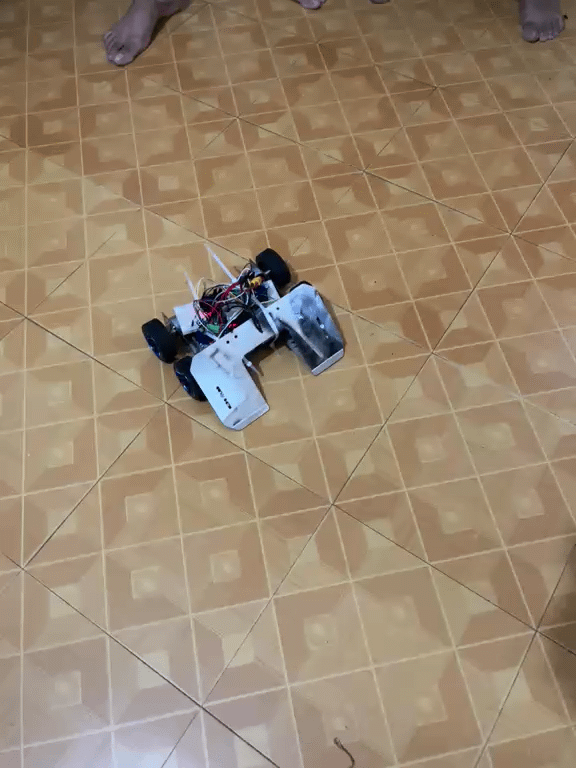
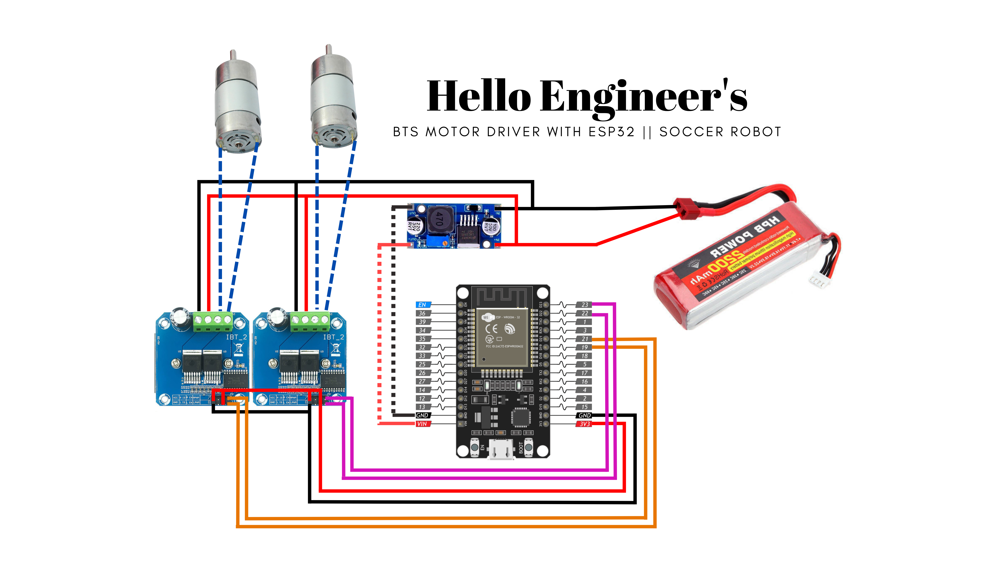

<div align="center">

# ESP32 Bluetooth Soccer Robot

**A fast, high-torque soccer robot controlled from a phone over Bluetooth.**

Built with ESP32 · BTS7960 motor drivers · 3S LiPo battery

<br>



<br>

[Overview](#overview) · [Hardware](#hardware) · [Wiring](#wiring) · [Firmware](#firmware) · [Controls](#controls) · [Competitions](#competitions) · [Team](#team)

</div>

---

## Overview

This robot is made for robot soccer. You drive it from your phone over Bluetooth. The ESP32 reads simple one-character commands and turns them into PWM signals for two BTS7960 motor drivers. The motors run directly from the 11.1V battery. A buck converter lowers the battery voltage to 5V for the ESP32.

**Key features**

- High torque for pushing and fast starts
- 10 speed levels, controlled from the phone
- Spin turns and curved turns in all directions
- Smooth speed ramping, so the motors do not reverse at full power in one instant
- Automatic stop when Bluetooth disconnects

## Hardware

| Component | Specification | Purpose |
|:--|:--|:--|
| Microcontroller | ESP32 (classic, WROOM-32) | Bluetooth and PWM control |
| Motor drivers | 2x BTS7960 (43A peak) | One driver for each side |
| Motors | 2x 37GB 800 RPM metal gear motors | Driving and pushing |
| Battery | 11.1V 3S LiPo | Main power |
| Regulator | XL4015 buck converter | 11.1V to 5V for the ESP32 |

> [!IMPORTANT]
> Set the XL4015 output to 5V with a multimeter before you connect the ESP32.

### Power flow

```
                 [ 11.1V 3S LiPo ]
                        │
          ┌─────────────┴─────────────┐
          ▼                           ▼
 [ BTS7960 Driver L & R ]     [ XL4015 Buck Converter ]
   (motor power line)            (11.1V to 5V)
          │                           │
          ▼                           ▼
   [ 2x 37GB Motors ]          [ ESP32 VIN & GND ]
```

<div align="center">

</div>

## Wiring

| Signal | ESP32 GPIO | Function |
|:--|:--:|:--|
| Left driver RPWM | 21 | Left side forward |
| Left driver LPWM | 19 | Left side backward |
| Right driver RPWM | 23 | Right side forward |
| Right driver LPWM | 22 | Right side backward |

- VCC, R_EN and L_EN of both BTS7960 modules are connected to the ESP32 3V3 pin. No enable pins are used in the code.
- The battery, drivers, buck converter and ESP32 must share a common ground.

## Firmware

The firmware is in [`soccer_bot_control.ino`](soccer_bot_control.ino).

- **Board:** ESP32 with classic Bluetooth (DevKit or WROOM-32). ESP32-S3 and C3 are not supported.
- **Core:** Arduino-ESP32 2.x and 3.x both work.
- **Bluetooth name:** `SoccerBot`
- **PWM:** 20 kHz, 8-bit (0 to 255)
- **Safety:** the robot stops if the Bluetooth connection is lost.
- **Ramping:** you can tune the acceleration with `RAMP_STEP` and `RAMP_INTERVAL_MS`.

### Getting started

1. Install the ESP32 board package in Arduino IDE.
2. Open `soccer_bot_control.ino`. If the IDE asks to move it into a folder, click OK.
3. Select your ESP32 board and port, then upload.
4. Power the robot and pair your phone with `SoccerBot`.
5. Connect with a Bluetooth RC car controller app that sends the characters in the table below.

> [!TIP]
> Test the robot with the wheels off the ground the first time.

## Controls

| Character | Action |
|:--:|:--|
| `F` / `B` | Forward / backward |
| `L` / `R` | Spin left / spin right |
| `G` / `H` | Forward left / forward right |
| `I` / `J` | Backward left / backward right |
| `S` | Stop |
| `0` to `9`, `q` | Speed level (`0` is stop, `5` is the default, `9` and `q` are full speed) |

## Competitions

- **ROBO LEAGUE 2026** · BRAC University Robotics Club (ROBU) · November 2026 · [Read the report](competitions/ROBO-LEAGUE-2026/README.md)

## Future Improvements

- Solder all connections on a dot board or PCB instead of using jumper wires.
- Add capacitors and better grounding on the power lines.
- Protect the electronics better against shocks from collisions.
- Test the robot under stall and collision load.

## Gallery

<table>
  <tr>
    <td width="50%"></td>
    <td width="50%"></td>
  </tr>
  <tr>
    <td align="center"><sub>Build and testing</sub></td>
    <td align="center"><sub>Hardware showcase</sub></td>
  </tr>
</table>

## Team

<div align="center">

</div>

<br>

This robot was built by a team of five students from BRAC University:

- Farhan ([@iamfarhan99](https://github.com/iamfarhan99))
- Shuvo
- Rahib
- Sajid
- Joya
