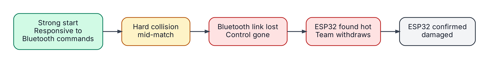
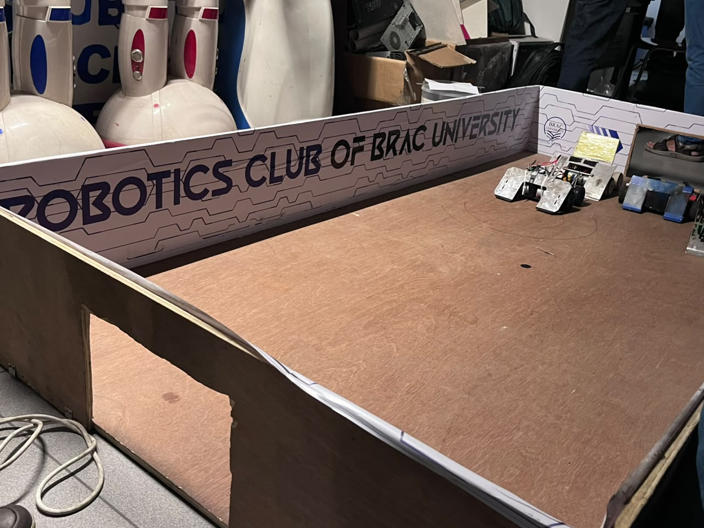
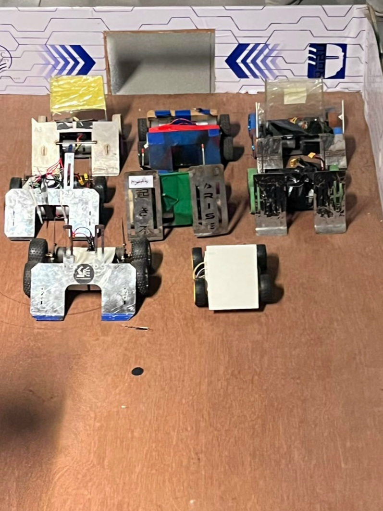
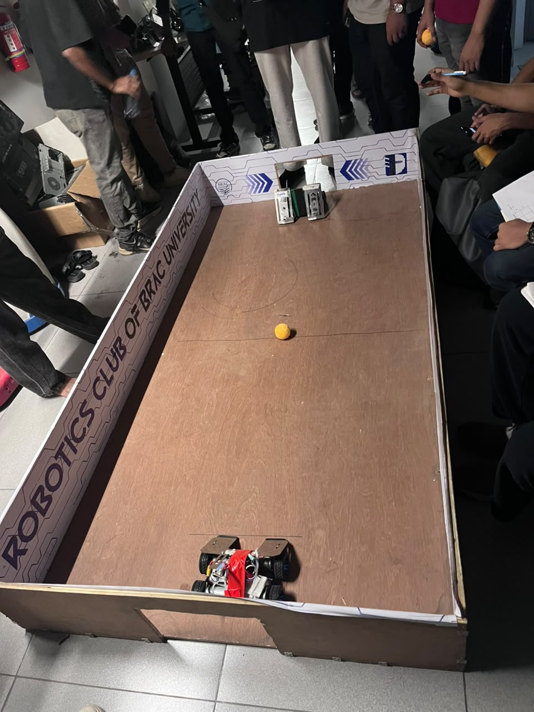

<h1 align="center">ROBO LEAGUE 2026</h1>

  <b>Event report for our ESP32 Bluetooth soccer robot</b>

  
  
  
  

  <a href="../../README.md">Back to the main project</a>

---

## Table of Contents

- [Event at a Glance](#event-at-a-glance)
- [Robot Setup](#robot-setup)
- [What Happened](#what-happened)
- [What Went Wrong](#what-went-wrong)
- [Fixes for the Next Version](#fixes-for-the-next-version)
- [Gallery](#gallery)
- [Participation Certificate](#participation-certificate)
- [What We Learned](#what-we-learned)

---

## Event at a Glance

| | |
|:--|:--|
| **Event** | ROBO LEAGUE 2026 |
| **Organiser** | Robotics Club of BRAC University (ROBU) |
| **Category** | Soccer Bot Competition |
| **Date** | November 2026 |
| **Robot** | ESP32-based Bluetooth soccer robot |
| **Status** | Participated |

---

## Robot Setup

| Part | Details |
|:--|:--|
| **Controller** | ESP32 with Bluetooth Classic and PWM motor control |
| **Motor drivers** | 2x BTS7960 high-current drivers |
| **Motors** | 2x 37GB 800 RPM metal gear motors |
| **Power** | 11.1 V 3S LiPo battery, with an XL4015 buck converter giving 5 V to the ESP32 |

For wiring and code, see the [main README](../../README.md).

---

## What Happened

  

The robot started the match well. It followed Bluetooth commands and had good acceleration and control. Then the robot suffered a hard collision, and the Bluetooth connection became unstable and finally dropped. We could no longer control the robot, so we withdrew from the match to protect the hardware.

---

## What Went Wrong

After the match, the ESP32 was very hot. Further testing showed that the ESP32 was **permanently damaged**. The rest of the robot was fine.

We could not find one exact cause. But everything points to an **electrical problem, not the code**. The code only reads one-letter commands and sets PWM outputs, so it is very unlikely to damage the board.

These are the three most likely causes:

| Likely cause | What it means |
|:--|:--|
| **Loose wires** | The robot used jumper wires. A hard hit can push a wire out of place and make it touch the wrong pin. |
| **Voltage spikes from the motors** | When a motor is stopped or reversed suddenly in a crash, it can send a sharp voltage spike back into the circuit. Our circuit had no protection against this. |
| **Power overload** | A crash makes the motors pull a lot of current, which can pull the battery voltage down. Also, the ESP32's 3V3 pin was powering the logic side of both motor drivers, so it carried extra load. |

---

## Fixes for the Next Version

Since we could not point to one cause, we will fix all three. This is what we will change:

| Problem | Fix |
|:--|:--|
| Wires can come loose in a crash | Solder everything on a dot-board or PCB |
| Motors send voltage spikes | Add protection parts (flyback diodes and optocoupler isolation) so spikes cannot reach the ESP32 |
| Battery voltage drops during hard hits | Add a large capacitor on the power lines to smooth out the drops |
| ESP32 powers the driver logic | Give the driver logic its own regulated power supply |
| Shocks reach the ESP32 | Mount it on shock-absorbing padding |
| The robot keeps its last command if the signal is lost without a clean disconnect | Add a timeout in the code: if no command arrives for a short time, stop the motors |
| We found the weak spots only during the match | Test the robot with hard stops and collisions before the next event |

---

## Gallery

   
  Competition arena

  
  &nbsp;&nbsp;&nbsp;
   
  Robot lineup &nbsp;&nbsp;|&nbsp;&nbsp; Robot in the arena

---

## Participation Certificate

  

---

## What We Learned

- How a self-built electronic system behaves under real competition stress
- How hard it is to debug a wireless connection in a noisy, crowded place
- That crash protection and clean power matter as much as speed and torque
- How to turn an unexplained failure into clear design changes
