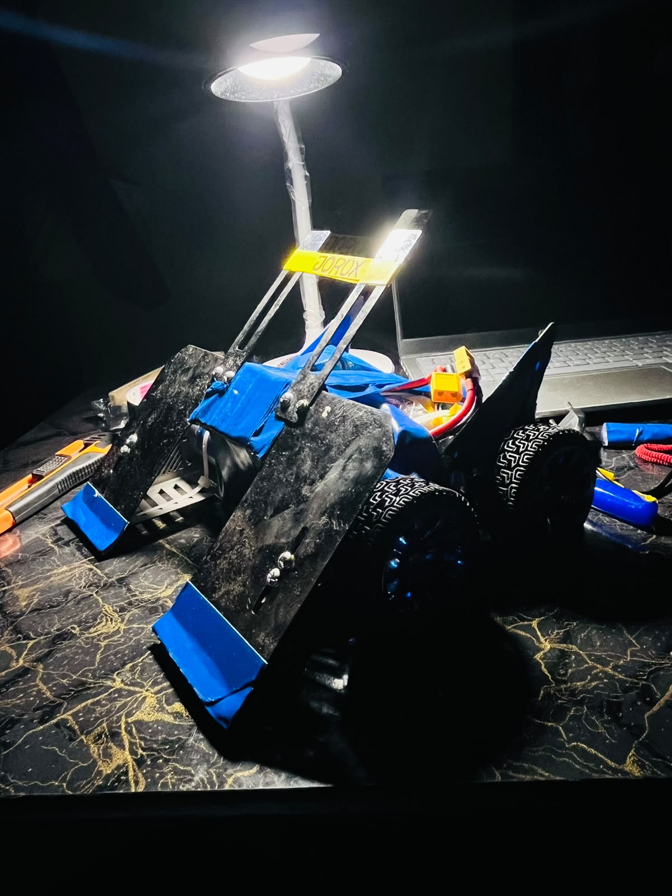
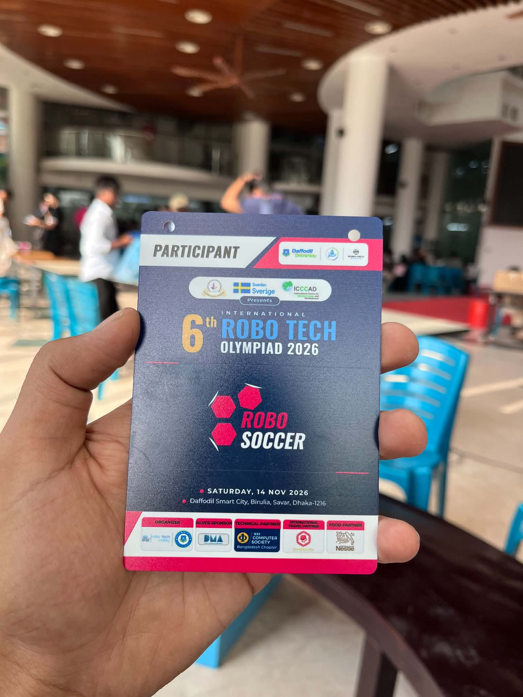
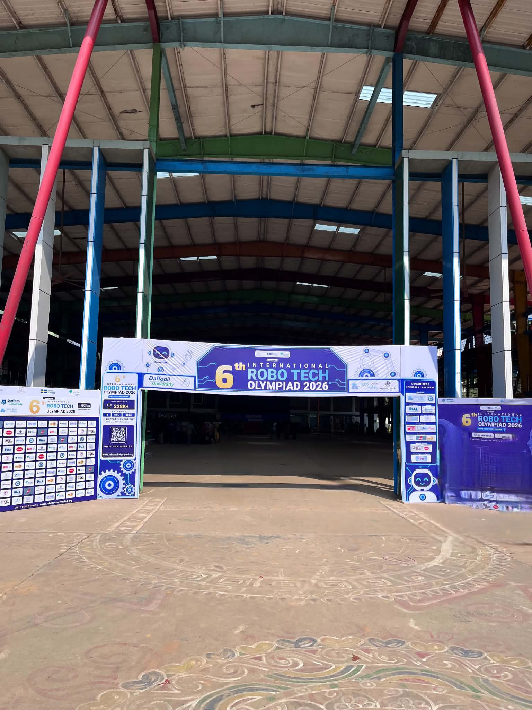
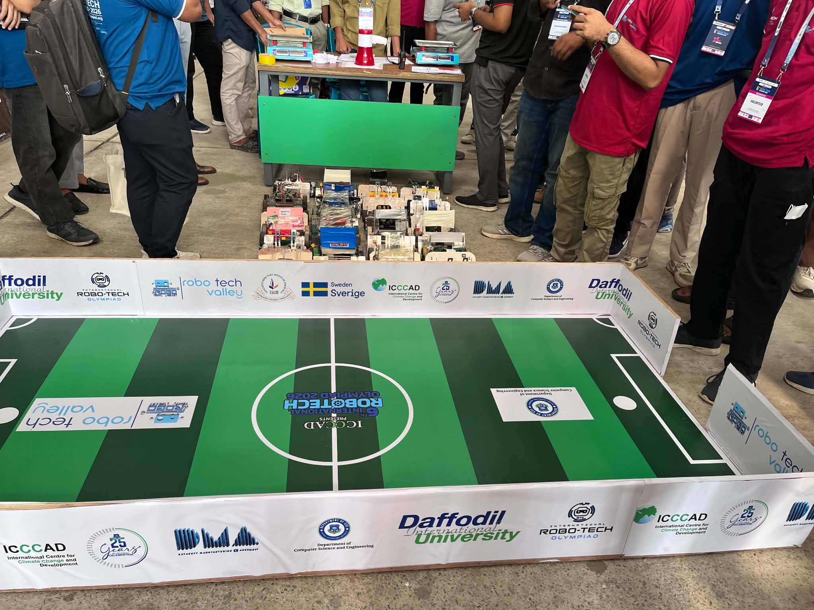
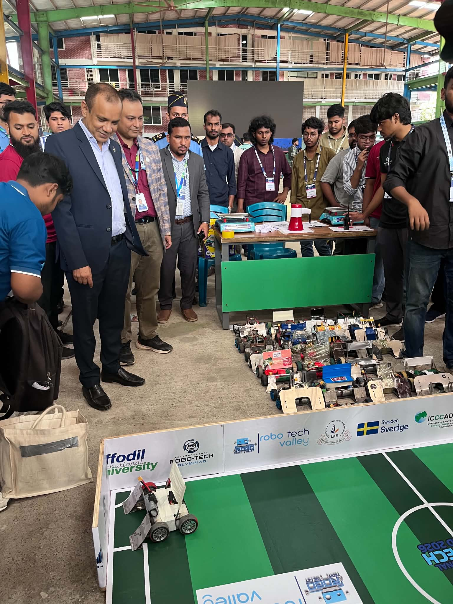

<h1 align="center">6th International Robo Tech Olympiad 2026</h1>

  <b>Competition report for our ESP32-based Bluetooth soccer robot</b>

  
  
  
  

  <a href="../../README.md">Back to the main project</a>

---

## Table of Contents

- [Event at a Glance](#event-at-a-glance)
- [Robot Setup](#robot-setup)
- [Upgrades Since ROBO LEAGUE 2026](#upgrades-since-robo-league-2026)
- [What Happened](#what-happened)
- [Issues Faced](#issues-faced)
- [Next Steps](#next-steps)
- [Team](#team)
- [Gallery](#gallery)
- [Participation Certificate](#participation-certificate)
- [What We Learned](#what-we-learned)

---

## Event at a Glance

| | |
|:--|:--|
| **Event** | 6th International Robo Tech Olympiad 2026 |
| **Organiser** | Robo Tech Valley, Daffodil International University |
| **Category** | Robo Soccer |
| **Date** | Saturday, 14 November 2026 |
| **Venue** | Daffodil Smart City, Birulia, Savar, Dhaka-1216 |
| **Participating institutions** | 65+ |
| **Bots in Robo Soccer** | 23 |
| **Our result** | **Top 8** |

  

---

## Robot Setup

| Part | Details |
|:--|:--|
| **Controller** | ESP32 with Bluetooth Classic and PWM motor control |
| **Motor drivers** | 2x BTS7960 high-current drivers |
| **Motors** | 2x 37GB 800 RPM metal gear motors |
| **Power** | 11.1 V 3S LiPo battery, with an XL4015 buck converter giving 5 V |
| **Control** | Android Bluetooth serial app |

For wiring and code, see the [main README](../../README.md).

---

## Upgrades Since [ROBO LEAGUE 2026](../ROBO-LEAGUE-2026/README.md)

After the power problems at ROBO LEAGUE, we reworked the power side of the robot before this event.

| Area | Before | After | Why |
|:--|:--|:--|:--|
| **Motor driver power** | No bulk capacitor | **1000 µF** capacitor across B+ and B- of the motor driver | Absorb voltage spikes and sags from the motors |
| **ESP32 supply** | No local capacitor | **470 µF** capacitor between ESP32 VIN and GND | Keep the logic supply stable |
| **Driver logic supply** | `VCC`, `R_EN` and `L_EN` of both drivers came from the ESP32 3V3 pin | `VCC`, `R_EN` and `L_EN` of both drivers come directly from the **buck converter 5 V** | The 3V3 pin carried the driver load and the ESP32 was getting hot |
| **Firmware** | ROBO LEAGUE version | Small changes in the latest `soccer_bot_control.ino` | [Added smooth acceleration/deceleration ramping, a short delay when reversing direction, and non-blocking motor updates] |

---

## What Happened

Our robot competed against 22 other bots in the Robo Soccer category and finished in the **top 8**. We did not reach the final podium. This was the first event where the upgraded power circuit was used in real competition, and the main problem of the day was an unstable Bluetooth connection.

---

## Issues Faced

### Bluetooth disconnections during matches

The ESP32 is paired directly with the driver's phone, and the link dropped several times during play.

| Possible cause | What it means |
|:--|:--|
| **Crowded wireless environment** | Many phones and devices were active in the venue at the same time |
| **Motor electrical noise** | The motor terminals had no 0.1 µF noise-suppression capacitors, so noise could reach the circuit |

These are suspected causes only. We have not confirmed which one was responsible.

---

## Next Steps

| Problem | Planned fix |
|:--|:--|
| Possible motor noise | Fit 0.1 µF ceramic capacitors across each motor's terminals |
| Phone-based Bluetooth link | Buy a dedicated controller |

---

## Team

| Member | Role |
|:--|:--|
| **[Farhan Shahriar Shihab](https://github.com/iamfarhan99)** | Driver, Firmware & Hardware Debugging |
| **[Ashraful Islam Shuvo](https://github.com/iamashrafulshuvo)** | Participant, Hardware Assembly & Debugging |
| **[Sadia Tanjim Joya](https://github.com/JOYA-USERNAME)** | Participant, Support |

---

## Gallery

### Event Day

  
  

<i>Participant badge &nbsp;|&nbsp; Event Gate</i>

### Arena & Robots

  

<i>Robo Soccer arena</i>

### Visit

  

<i>Visit by the University Officials</i>

---

## Participation Certificate

  

---

## What We Learned

- Bulk capacitors and a separate 5 V supply for the driver logic make the power side much more stable
- Wireless links behave very differently in a crowded venue than on the test bench
- A phone is not a reliable controller for competition, so a dedicated controller is our next step
- A bigger event with 65+ institutions showed us how much preparation and testing matter
